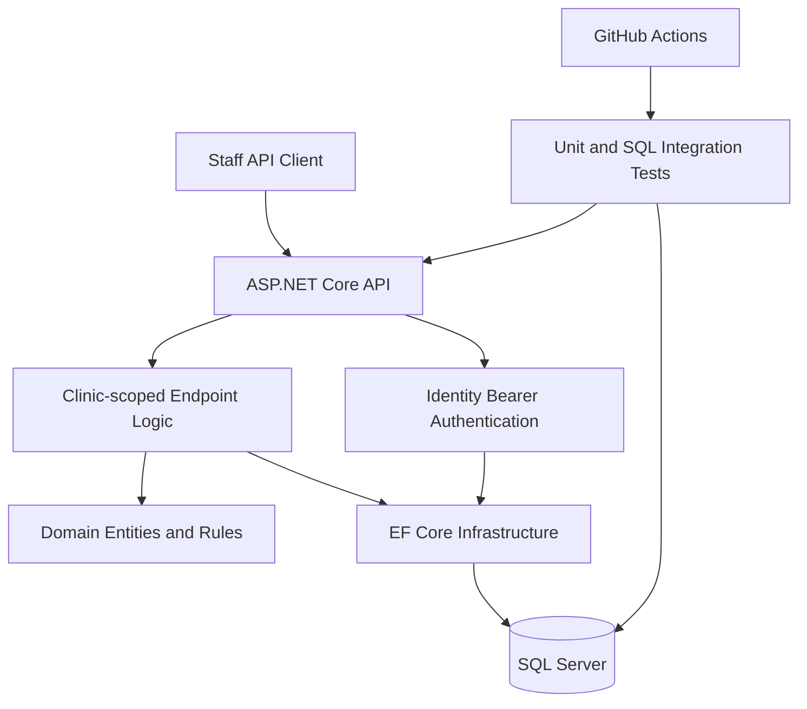

# CareFlow

**A healthcare operations backend portfolio project built with C#, ASP.NET Core 10, Entity Framework Core and SQL Server.**

CareFlow demonstrates multi-clinic access control, staff authentication, patient and practitioner management, transaction-safe appointment scheduling, lifecycle tracking and aggregate operational reporting.

> **Portfolio prototype only.** Use fictional patient and clinic data. This is not a deployed, clinically validated or regulatory-compliant healthcare system.

## Capabilities

| Area | Functionality |
| --- | --- |
| Authentication | ASP.NET Core Identity bearer tokens, login lockout, restricted initial administrator bootstrap |
| Patients | Create, search, view and update clinic-scoped patient records with SQL Server concurrency control |
| Practitioners | Register, find, update and deactivate practitioners; block deactivation with upcoming bookings |
| Scheduling | Define availability, book appointments, prevent practitioner and patient double bookings, cancel or reschedule |
| Lifecycle | Record check-in time, prevent duplicate check-in, complete appointments, retain audit history |
| Clinic view | Browse a seven-day UTC schedule with optional practitioner filter |
| Reporting | Administrator-only appointment counts, status breakdown, attendance proxy and practitioner workload |
| Verification | .NET builds, unit tests, EF Core migration validation and SQL Server integration tests in GitHub Actions |

CareFlow is a **backend-first modular monolith**. There is no web or mobile UI.

## Architecture



See [architecture](docs/architecture.md), [database design](docs/database-design.md) and the [portfolio case study](docs/portfolio-case-study.md).

## Run locally

**Requirements:** .NET 10 SDK, Docker Desktop with a compatible SQL Server container runtime (or your own SQL Server 2022+ instance), and `dotnet-ef` 10.0.14.

1. Create a local `.env` from `.env.example`, replacing the SQL administrator password with a unique strong value. The `.env` file is ignored by Git.
2. Start the development database:

   ```bash
   docker compose up -d
   ```

3. Set the `ConnectionStrings__CareFlowDb` environment variable with the same local database password. Example format (replace the placeholder privately):

   ```text
   Server=localhost,1433;Database=CareFlowDb;User Id=sa;Password=YOUR_LOCAL_PASSWORD;Encrypt=True;TrustServerCertificate=True
   ```

   Do not put real credentials into source code, committed scripts or screenshots.

4. Apply the **committed** EF Core migrations:

   ```bash
   dotnet tool install --global dotnet-ef --version 10.0.14
   dotnet ef database update --project src/CareFlow.Infrastructure --startup-project src/CareFlow.Api --context CareFlowDbContext
   ```

5. Build and run:

   ```bash
   dotnet restore CareFlow.slnx
   dotnet build CareFlow.slnx
   dotnet test CareFlow.slnx
   dotnet run --project src/CareFlow.Api --launch-profile http
   ```

   Local development endpoints: `http://localhost:5084/health/live` and `http://localhost:5084/openapi/v1.json`. The launch profile uses HTTP **only for local development**. Use HTTPS for actual authentication and API calls outside localhost.

6. Provision the first administrator for a **new fictional clinic** using the guarded CLI. Set `CAREFLOW_BOOTSTRAP_CLINIC_CODE`, `CAREFLOW_BOOTSTRAP_CLINIC_NAME`, `CAREFLOW_BOOTSTRAP_EMAIL` and `CAREFLOW_BOOTSTRAP_PASSWORD` privately as environment variables, then run:

   ```bash
   dotnet run --project tools/CareFlow.Bootstrap -- --confirm-initial-admin
   ```

   This command refuses to re-provision an existing clinic; it is not a public signup flow.

7. Sign in via `POST /api/v1/auth/login` and use the returned `accessToken` in the `Authorization: Bearer ...` header. Follow the fictional-data [demo runbook](docs/demo-runbook.md).

The SQL Server SA account and `TrustServerCertificate=True` are for **local development only**. Apple Silicon users may need SQL Server-compatible emulation or a separately hosted SQL Server.

## Key API routes

| Method | Route | Purpose |
| --- | --- | --- |
| POST | `/api/v1/auth/login` | Staff login |
| GET / POST / PUT | `/api/v1/patients` | Clinic patient management (individual updates use `/{id}`) |
| GET / POST / PUT | `/api/v1/practitioners` | Practitioner management |
| POST | `/api/v1/practitioners/{id}/deactivate` | Deactivate practitioner safely |
| GET / POST | `/api/v1/availability` | Practitioner availability |
| POST | `/api/v1/appointments` | Book appointment |
| GET | `/api/v1/appointments/{id}` | Appointment detail |
| POST | `/api/v1/appointments/{id}/reschedule` | Move booking |
| POST | `/api/v1/appointments/{id}/cancel` | Cancel booking |
| POST | `/api/v1/appointments/{id}/check-in` | Record arrival |
| POST | `/api/v1/appointments/{id}/complete` | Complete checked-in booking |
| GET | `/api/v1/schedule` | Clinic schedule |
| GET | `/api/v1/reports/appointments` | Administrator reporting |

See [patient API](docs/patient-api.md), [appointment API](docs/appointment-api.md), [appointment lifecycle](docs/appointment-lifecycle.md), [practitioner API](docs/practitioner-api.md), [clinic scheduling](docs/scheduling-dashboard.md) and [reporting](docs/clinic-reporting.md).

## Testing

```bash
dotnet test CareFlow.slnx
dotnet test tests/CareFlow.IntegrationTests/CareFlow.IntegrationTests.csproj
```

The integration suite requires a running SQL Server and the `ConnectionStrings__CareFlowDb` environment variable. **Use a disposable test database**: tests create fictional clinics, users, patients and bookings.

GitHub Actions runs the integration suite against a disposable SQL Server container. A separate workflow validates EF Core model/migration consistency and applies committed migrations. Review the green checks on each PR; test counts can change as coverage expands.

## Security and limits

- The caller never chooses a tenant/clinic ID in patient, practitioner, scheduling or reporting operations.
- Access is checked against active clinic membership and current staff roles.
- Sensitive API responses are marked non-cacheable, and initial login is rate limited.
- Booking uses SQL Server SERIALIZABLE transactions plus rowversion-based update checks.
- A completed booking stays in the database for historical reporting; check-in has its own persisted timestamp.
- Subsequent staff onboarding, token revocation, production deployment, audit retention, threat modelling and real healthcare compliance are **out of scope** for this portfolio release.

See [hardening notes](docs/backend-hardening.md) for limitations and additional production controls.

## Portfolio walkthrough

A reviewer can follow the [demo runbook](docs/demo-runbook.md) to provision a fictional clinic, register a patient and practitioner, create availability, book an appointment, observe a conflict and inspect an administrator report.

**Project scope:** backend architecture, secure access, relational data modelling, REST endpoints, transactional booking and automated integration testing.
